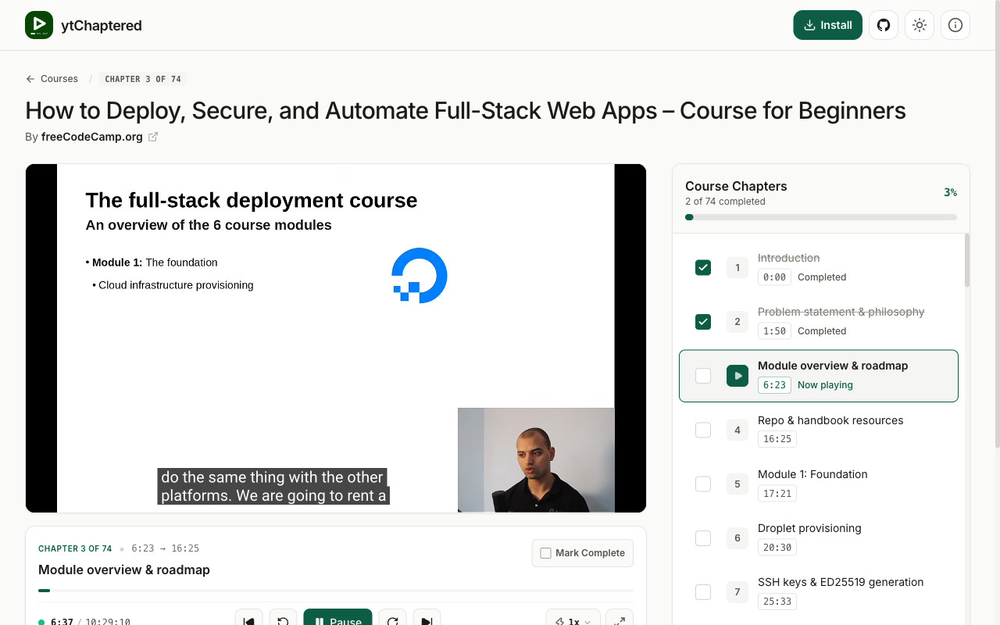

# Turn long YouTube videos into interactive chapter playlists

ytChaptered is a local-first web application that converts timestamped YouTube videos into structured course playlists. You paste a video URL, extract chapters from the video description, and track your learning progress directly in your browser.

<p align="center">
  <a href="https://github.com/shamsadanam/yt-chaptered/raw/main/public/demo.mp4" title="Watch Demo Video">
    
  </a>
  <br />
  <em>▶ Click the preview above to watch the walkthrough demo video (<a href="public/demo.mp4">public/demo.mp4</a>)</em>
</p>

## Core features

ytChaptered helps you study long video tutorials with dedicated playback and progress controls. Key capabilities include:

- **Automatic timestamp parsing**: The app detects timestamp markers in video descriptions and creates ordered chapter breaks.
- **Interactive chapter checklist**: You mark finished chapters, inspect remaining topics, and resume playback where you stopped.
- **Local browser storage**: Your saved courses and chapter completions stay private in your browser’s IndexedDB database.
- **Progressive Web App support**: You can install ytChaptered as a Progressive Web App (PWA) on desktop or mobile devices.
- **JSON library backup**: You export your course collection to a JavaScript Object Notation (JSON) file and restore it on any browser.

## Getting started

Follow these steps to set up and run ytChaptered on your local machine. You need Node.js 20 or later and the pnpm package manager installed.

1. Clone the repository and navigate into the project directory:

```bash
git clone https://github.com/shamsadanam/yt-chaptered.git
cd yt-chaptered
```

2. Install project dependencies using pnpm:

```bash
pnpm install
```

3. Configure optional environment variables:

```bash
cp .env.example .env.local
```

Development runs with dummy Cloudflare Turnstile keys automatically when environment variables are omitted. For production deployments, set your actual site key and secret key in `.env.local`.

4. Start the local development server:

```bash
pnpm dev
```

Open the [local development server](http://localhost:3000) in your browser to explore the application.

## Project architecture

The application uses the Next.js App Router and manages playback state on the client. Key architectural components include:

- **Next.js App Router**: Client routes under `app/page.tsx` and `app/watch/[id]/page.tsx` render the dashboard and player interfaces with React 19.
- **IndexedDB client storage**: The `lib/storage.ts` module manages local course records without external database dependencies.
- **YouTube IFrame API**: The `hooks/useYouTubePlayer.ts` hook coordinates video seeking, playback states, and chapter boundaries.
- **Design tokens**: Visual styling follows custom design tokens defined in `app/globals.css` with dark mode support.

## Available scripts

You can run several development and maintenance scripts using pnpm:

- **pnpm dev**: Starts the Next.js development server at port 3000.
- **pnpm build**: Compiles the production build with Turbopack.
- **pnpm start**: Runs the compiled production server locally.
- **pnpm lint**: Checks code style and TypeScript rules using ESLint.

## Data privacy and security

ytChaptered prioritizes your privacy by storing your personal learning history on your device. No video bookmarks or completion records transmit to third-party servers.

Automated metadata fetching runs through rate-limited API routes protected by Cloudflare Turnstile verification. You can also paste timestamps manually without calling server endpoints.
