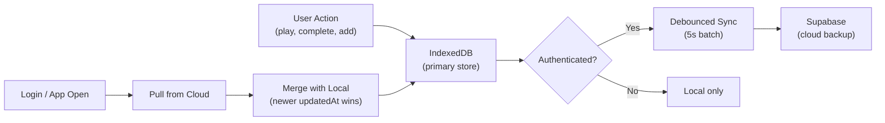

# Priority 1: Fullscreen Overlay, In-App Search & Progress Sync

## Overview

Three features from the [todo.md](../../todo.md) Priority 1 roadmap:

1. **Fullscreen Overlay** — Show chapter list + player controls inside fullscreen mode
2. **In-App YouTube Search** — Search YouTube from within the app, detect "chapterable" videos
3. **Progress Sync** — Sync course progress to a cloud backend (Google Drive or free DB)

All three are **feasible** with the current architecture. Below is a detailed build plan for each.

---

## Feasibility Summary

| Feature | Feasible? | Complexity | New Dependencies | Infra Needed |
|---|---|---|---|---|
| Fullscreen Overlay | ✅ Yes | Medium | None | None |
| In-App YouTube Search | ✅ Yes | Medium | None (uses existing Innertube pattern) | None (no API key) |
| Progress Sync | ✅ Yes | High | Auth provider SDK | Google Cloud / Supabase account |

---

## Feature 1: Fullscreen Chapter Overlay & Player Controls

### Current State

The app already has a **custom fullscreen implementation** in [`PlaylistView.tsx`](../../components/PlaylistView.tsx#L291-L344). It calls `requestFullscreen()` on a `playerWrapperRef` div — **not** on the YouTube iframe directly. This means the wrapper div goes fullscreen and the app retains full control over what's rendered inside it.

Currently, only the YouTube iframe and an "Exit" button are shown in fullscreen. The chapter sidebar and playback controls are hidden because they're outside the fullscreen wrapper.

### Approach

Move the chapter list and controls **inside** the fullscreen wrapper, displayed as a togglable overlay panel.

```
┌──────────────────────────────────────────────────────┐
│  FULLSCREEN WRAPPER (playerWrapperRef)               │
│  ┌────────────────────────────────────────────────┐  │
│  │                                                │  │
│  │            YouTube Player (iframe)              │  │
│  │                                                │  │
│  └────────────────────────────────────────────────┘  │
│                                                      │
│  ┌─ Overlay Panel (slides in from right) ──────────┐ │
│  │  ☰ Chapter 1: Intro           ✓  0:00          │ │
│  │  ▶ Chapter 2: Setup           ○  3:42          │ │
│  │    Chapter 3: Advanced        ○  12:15         │ │
│  │    ...                                         │ │
│  └─────────────────────────────────────────────────┘ │
│                                                      │
│  ┌─ Bottom Controls Bar ───────────────────────────┐ │
│  │  ⏮  ⏪  ▶/⏸  ⏩  ⏭  │  1.5x  │  ⛶ Exit     │ │
│  └─────────────────────────────────────────────────┘ │
└──────────────────────────────────────────────────────┘
```

### Implementation Plan

#### [MODIFY] `components/PlaylistView.tsx`

1. **Add overlay state:**
   ```tsx
   const [isOverlayOpen, setIsOverlayOpen] = useState(false);
   ```

2. **Render chapter overlay + controls bar inside the fullscreen wrapper** (inside the `playerWrapperRef` div, alongside the existing iframe and Exit button):
   ```tsx
   {isFullscreen && (
     <>
       {/* Toggle overlay button — always visible in fullscreen */}
       <button
         onClick={() => setIsOverlayOpen(!isOverlayOpen)}
         className="absolute top-4 left-4 z-50 ..."
         aria-label={isOverlayOpen ? 'Hide chapters' : 'Show chapters'}
       >
         <List className="w-4 h-4" />
       </button>

       {/* Slide-in chapter panel */}
       {isOverlayOpen && (
         <div className="absolute right-0 top-0 bottom-12 w-72 sm:w-80 z-40 bg-black/90 backdrop-blur-sm overflow-y-auto ...">
           {/* Reuse same chapter list markup */}
         </div>
       )}

       {/* Bottom transport controls bar */}
       <div className="absolute bottom-0 left-0 right-0 z-40 bg-gradient-to-t from-black/90 to-transparent px-4 py-3 ...">
         {/* Prev | -10s | Play/Pause | +10s | Next | Speed | Exit */}
       </div>
     </>
   )}
   ```

3. **Extract shared chapter list + controls into reusable sub-components** to avoid duplicating the sidebar and controls markup:
   - `FullscreenChapterPanel` — scrollable chapter list with completion toggles
   - `TransportControls` — play/pause, skip, seek, speed, fullscreen toggle

4. **Auto-hide overlay** after 5 seconds of inactivity, show on tap/mouse move (like native video players):
   ```tsx
   const hideTimerRef = useRef<NodeJS.Timeout | null>(null);
   const [overlayVisible, setOverlayVisible] = useState(true);

   const resetHideTimer = useCallback(() => {
     setOverlayVisible(true);
     if (hideTimerRef.current) clearTimeout(hideTimerRef.current);
     hideTimerRef.current = setTimeout(() => setOverlayVisible(false), 5000);
   }, []);
   ```

5. **Keyboard shortcuts in fullscreen:**
   - `Escape` → exit fullscreen (already handled by browser)
   - `I` → toggle chapter panel
   - `Space` → play/pause
   - Arrow keys → seek ±10s

6. **Portrait mode:** On mobile portrait fullscreen (where the video rotates 90°), the overlay controls should also rotate with the inner wrapper. The existing rotation transform on the inner `div` already handles this — the overlay lives inside that same rotated container.

### Key Constraints

- The YouTube iframe's own controls (play button, progress bar) are still visible inside the iframe. The app's overlay controls sit **above** the iframe via `z-index`. Users can use either.
- YouTube ToS: overlaying UI is fine as long as ads and branding aren't blocked. The chapter panel covers the right edge only, and the bottom bar sits below the iframe's native controls area.

### Files Changed

| File | Action |
|---|---|
| `components/PlaylistView.tsx` | Modify — add overlay rendering inside fullscreen wrapper |
| `components/FullscreenOverlay.tsx` | New — extracted chapter panel + transport bar |

---

## Feature 2: In-App YouTube Search

### Current State

Videos are added by pasting a URL. The app fetches metadata via YouTube's **Innertube API** (no API key needed) in [`route.ts`](../../app/api/protected/youtube-info/route.ts#L171-L238). Chapter detection uses `macroMarkersListItemRenderer` from Innertube's `/next` endpoint, with fallbacks to HTML scraping and description timestamp parsing.

### Approach: Innertube Search (No API Key Needed)

YouTube's Innertube v1 `/search` endpoint is the same internal API that `youtube.com` uses. It returns structured JSON — no scraping needed, no API key. The app already uses two Innertube endpoints (`/player` and `/next`), so this is a natural extension.

```
POST https://www.youtube.com/youtubei/v1/search?prettyPrint=false
Content-Type: application/json

{
  "query": "react tutorial",
  "context": {
    "client": {
      "clientName": "WEB",
      "clientVersion": "2.20240101.00.00",
      "hl": "en",
      "gl": "US"
    }
  }
}
```

The response contains `videoRenderer` objects with `videoId`, `title`, `thumbnail`, `lengthText`, `ownerText`, and `descriptionSnippet`.

### "Chapterable" Detection

A video is "chapterable" if its description contains timestamp patterns (e.g., `0:00 Intro`, `3:42 Setup`). The existing [`parseTimestamps()`](../../lib/youtubeParser.ts) function already does this. For search results, we can check the `descriptionSnippet` for timestamp-like patterns and additionally call the `/next` endpoint to check for `macroMarkersListItemRenderer`.

**Two-tier detection:**
1. **Quick scan (in search results):** Check if `descriptionSnippet` contains timestamp patterns → show a tentative "Likely has chapters" badge
2. **Confirmed (on hover/expand):** Call `/next` for the specific video to check for native chapter markers → show a confirmed "Has chapters ✓" badge

### Implementation Plan

#### [NEW] `app/api/protected/youtube-search/route.ts`

```ts
export async function GET(request: NextRequest) {
  // Same Turnstile + rate-limit guards as youtube-info route
  const query = searchParams.get('q');
  if (!query || query.trim().length < 2) {
    return NextResponse.json({ success: false, error: 'Query too short' }, { status: 400 });
  }

  const innertubeBody = {
    query: query.trim(),
    context: {
      client: {
        clientName: 'WEB',
        clientVersion: '2.20240101.00.00',
        hl: 'en', gl: 'US',
      },
    },
  };

  const res = await fetch(
    'https://www.youtube.com/youtubei/v1/search?prettyPrint=false',
    {
      method: 'POST',
      headers: { 'Content-Type': 'application/json' },
      body: JSON.stringify(innertubeBody),
    }
  );

  // Parse videoRenderer items from response
  // Return: { results: [{ videoId, title, thumbnail, duration, author, hasTimestamps }] }
}
```

#### [NEW] `components/SearchModal.tsx`

A modal dialog (consistent with existing `AddCourseModal` pattern) containing:
- Search input with debounced requests (300ms)
- Results list showing: thumbnail, title, author, duration
- "Has Chapters" badge on videos with detected timestamps
- Click result → navigates to `/watch/[id]` (same flow as adding a pasted URL)

```
┌─────────────────────────────────────────────┐
│  🔍 Search YouTube                     [×]  │
│  ┌────────────────────────────────────────┐  │
│  │ react hooks tutorial                  │  │
│  └────────────────────────────────────────┘  │
│                                              │
│  ┌──┐ React Hooks Crash Course         │  │
│  │🖼│ Traversy Media • 1:22:15         │  │
│  │  │ 📑 Has Chapters                  │  │
│  └──┘                                   │  │
│  ┌──┐ useEffect Explained              │  │
│  │🖼│ Web Dev Simplified • 15:30       │  │
│  │  │                                   │  │
│  └──┘                                   │  │
│  ┌──┐ React for Beginners             │  │
│  │🖼│ freeCodeCamp • 5:04:27          │  │
│  │  │ 📑 Has Chapters                  │  │
│  └──┘                                   │  │
└─────────────────────────────────────────────┘
```

#### [MODIFY] `components/Navbar.tsx`

Add a search icon/button to the navbar that opens the `SearchModal`.

#### [MODIFY] `components/MobileTabBar.tsx`

Add a search tab or replace the "create" action with a search modal trigger.

#### [MODIFY] `app/page.tsx`

Wire up search modal state.

### Key Constraints

- **Rate limiting:** The Innertube search endpoint is rate-limited by YouTube. The existing Turnstile bot-protection + IP-based rate limiter in the API route will throttle abuse. Add a slightly stricter limit for search (e.g., 30 searches/day per IP instead of the general limit).
- **No API key needed.** This is the same API the YouTube website uses. No Google Cloud setup required.
- **Result quality:** Innertube returns the same results as youtube.com search.

### Files Changed

| File | Action |
|---|---|
| `app/api/protected/youtube-search/route.ts` | New — Innertube search API route |
| `components/SearchModal.tsx` | New — search UI modal |
| `components/Navbar.tsx` | Modify — add search button |
| `components/MobileTabBar.tsx` | Modify — add search access |
| `app/page.tsx` | Modify — wire search modal |
| `lib/rateLimit.ts` | Modify — add search-specific rate limit bucket |

---

## Feature 3: Progress Sync (Google Drive or Free DB)

### Current State

All data lives in **IndexedDB** via [`lib/storage.ts`](../../lib/storage.ts). The data model is simple:
- `SavedCourse[]` — each ~1-5KB
- Total data for a typical user: **under 50KB**

No authentication, no cloud integration. The app already has `exportCoursesJson()` / `importCoursesJson()` for manual backup.

### Recommended Approach: Supabase (Free Tier)

> [!IMPORTANT]
> This is a **significant architecture decision**. There are multiple viable approaches — the choice depends on your priorities around infrastructure ownership, user friction, and future features.

#### Option A: Supabase (Recommended)

| Aspect | Detail |
|---|---|
| **Free tier** | 50K monthly active users, 500MB database, 1GB file storage |
| **Auth** | Built-in Google OAuth, Magic Link, GitHub — zero custom auth code |
| **Sync** | Realtime subscriptions (Postgres changes → client push) |
| **Conflict resolution** | Server timestamp wins (last-write-wins with `updatedAt`) |
| **Migration** | Export existing IndexedDB → bulk upsert on first login |
| **Offline** | IndexedDB remains the primary store; Supabase syncs when online |

#### Option B: Google Drive `appDataFolder`

| Aspect | Detail |
|---|---|
| **Free** | Yes, uses user's own Drive quota (50KB is negligible) |
| **Auth** | Google OAuth 2.0 — must set up Google Cloud Console, consent screen |
| **Sync** | Manual pull/push (no realtime); app reads/writes a single JSON file |
| **Conflict resolution** | Merge by `updatedAt` per course on each sync |
| **Drawback** | Google OAuth consent screen requires verification for production (can take weeks) |

#### Option C: Export/Import JSON (Already Partially Exists)

The simplest path. `exportCoursesJson()` and `importCoursesJson()` already exist in `storage.ts`. Just add UI buttons to trigger them. **No cloud, no auth, no infra.** This could be shipped immediately as a stopgap while the cloud solution is built.

### Implementation Plan (Supabase Path)

#### Phase 1: Auth & Database Setup

1. **Create Supabase project** (free tier)
2. **Enable Google OAuth** provider in Supabase dashboard
3. **Database schema:**

```sql
CREATE TABLE courses (
  id UUID DEFAULT gen_random_uuid() PRIMARY KEY,
  user_id UUID REFERENCES auth.users(id) ON DELETE CASCADE NOT NULL,
  video_id TEXT NOT NULL,
  data JSONB NOT NULL,        -- Full SavedCourse object
  updated_at TIMESTAMPTZ DEFAULT now() NOT NULL,
  UNIQUE (user_id, video_id)
);

-- Row-level security: users can only access their own rows
ALTER TABLE courses ENABLE ROW LEVEL SECURITY;

CREATE POLICY "Users own their courses"
  ON courses FOR ALL
  USING (auth.uid() = user_id)
  WITH CHECK (auth.uid() = user_id);

CREATE INDEX idx_courses_user ON courses(user_id);
```

#### Phase 2: Client Integration

#### [NEW] `lib/supabase.ts`

```ts
import { createClient } from '@supabase/supabase-js';

export const supabase = createClient(
  process.env.NEXT_PUBLIC_SUPABASE_URL!,
  process.env.NEXT_PUBLIC_SUPABASE_ANON_KEY!
);
```

#### [NEW] `lib/sync.ts`

Core sync logic:
```ts
export async function syncToCloud(localCourses: SavedCourse[]): Promise<void> {
  // 1. Fetch all remote courses for user
  // 2. Merge: for each course, keep the one with newer updatedAt
  // 3. Upsert merged set to Supabase
  // 4. Update local IndexedDB with any remote-newer courses
}

export async function pullFromCloud(): Promise<SavedCourse[]> {
  // Fetch all courses for authenticated user
}

export async function pushToCloud(courses: SavedCourse[]): Promise<void> {
  // Upsert all local courses to Supabase
}
```

#### [NEW] `components/AuthButton.tsx`

Sign in / Sign out button with Google OAuth:
```tsx
const handleSignIn = () => supabase.auth.signInWithOAuth({ provider: 'google' });
const handleSignOut = () => supabase.auth.signOut();
```

#### [NEW] `components/SyncStatus.tsx`

Visual sync indicator: "Synced ✓", "Syncing...", "Offline (local only)", "Sign in to sync"

#### [MODIFY] `lib/storage.ts`

After each write operation (`saveCourse`, `updateCoursePlaybackProgress`, `markChapterCompleted`, `toggleChapterCompletion`, `deleteSavedCourse`), queue a debounced cloud sync if the user is authenticated:

```ts
function queueCloudSync(videoId: string) {
  if (!isAuthenticated()) return;
  // Debounce by 5 seconds to batch rapid progress updates
  debouncedPushCourse(videoId);
}
```

#### [MODIFY] `components/Navbar.tsx`

Add auth button + sync status indicator.

#### [MODIFY] `.env.example`

```
NEXT_PUBLIC_SUPABASE_URL=
NEXT_PUBLIC_SUPABASE_ANON_KEY=
```

### Data Flow



### Files Changed

| File | Action |
|---|---|
| `lib/supabase.ts` | New — Supabase client |
| `lib/sync.ts` | New — sync/merge logic |
| `components/AuthButton.tsx` | New — Google sign-in |
| `components/SyncStatus.tsx` | New — sync status UI |
| `lib/storage.ts` | Modify — add sync hooks after writes |
| `components/Navbar.tsx` | Modify — add auth + sync UI |
| `.env.example` | Modify — add Supabase env vars |
| `package.json` | Modify — add `@supabase/supabase-js` |

---

## Verification Plan

### Feature 1: Fullscreen Overlay

#### Manual Verification
1. Open a video with chapters → click the fullscreen button
2. Verify the chapter panel toggle button appears (top-left)
3. Click it → chapter list slides in from the right
4. Click a chapter → video seeks to that timestamp
5. Verify play/pause, skip, seek controls work in the bottom bar
6. Verify auto-hide after 5s of inactivity, reappear on mouse move/tap
7. Test on mobile portrait → verify overlay rotates correctly
8. Press Escape → exits fullscreen
9. Verify keyboard shortcuts: Space (play/pause), I (toggle chapters)

#### Automated Tests
```bash
pnpm build   # Ensure no TypeScript errors
pnpm lint    # Ensure no lint errors
```

### Feature 2: In-App YouTube Search

#### Manual Verification
1. Click search icon in navbar → search modal opens
2. Type a query → results appear after debounce
3. Verify results show thumbnail, title, author, duration
4. Verify "Has Chapters" badge appears on videos with timestamps in description
5. Click a result → navigates to `/watch/[videoId]`
6. Verify rate limiting works (try rapid searches)
7. Test empty query, very short query, special characters

#### Automated Tests
```bash
pnpm build
pnpm lint
# Optionally: curl the search API route locally
curl "http://localhost:3000/api/protected/youtube-search?q=react+tutorial" \
  -H "Referer: http://localhost:3000"
```

### Feature 3: Progress Sync

#### Manual Verification
1. Click "Sign in with Google" → OAuth flow completes
2. Add a video and complete some chapters
3. Verify sync indicator shows "Synced ✓"
4. Open the app in a different browser/incognito → sign in → verify courses appear
5. Complete chapters in browser 2 → refresh browser 1 → verify progress merged
6. Sign out → verify app still works locally
7. Test offline: disconnect network, make progress, reconnect → verify sync resumes
8. Test conflict: modify same course in two browsers offline, reconnect both → verify newer wins

#### Automated Tests
```bash
pnpm build
pnpm lint
# Supabase local dev:
npx supabase start       # Starts local Supabase
npx supabase db reset    # Apply migrations
```

---

## Suggested Build Order

> [!TIP]
> These features are independent and can be built in parallel, but the recommended sequence minimizes rework.

1. **Feature 1: Fullscreen Overlay** — Pure frontend, no infra, no dependencies. Ships fastest.
2. **Feature 2: In-App Search** — API route + UI. No external dependencies. Medium effort.
3. **Feature 3: Progress Sync** — Requires Supabase setup, OAuth configuration, and careful sync logic. Highest effort but highest long-term value.

**Quick Win (immediate):** Before tackling Feature 3's cloud sync, add Export/Import buttons to the UI — `exportCoursesJson()` and `importCoursesJson()` already exist in storage.ts and just need a UI surface.

---

## Open Questions

> [!IMPORTANT]
> **Sync Provider Decision:** Do you prefer **Supabase** (recommended — easier auth, realtime sync, free tier) or **Google Drive** `appDataFolder` (free, no external DB, but more complex OAuth setup and manual sync)?

> [!IMPORTANT]
> **Search Scope:** Should the search modal **replace** the existing "paste URL" add-video flow, or exist alongside it? (Recommendation: alongside — keep URL paste as a power-user shortcut, search as the primary discovery method.)

> [!NOTE]
> **Fullscreen overlay design:** Should the chapter panel auto-open when entering fullscreen, or start hidden with just the toggle button visible? (Recommendation: start hidden — less visual clutter, especially on mobile.)
